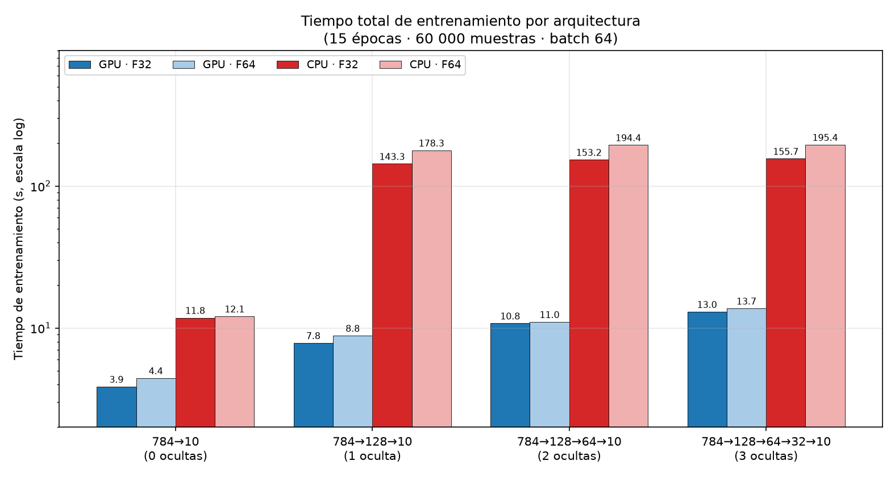
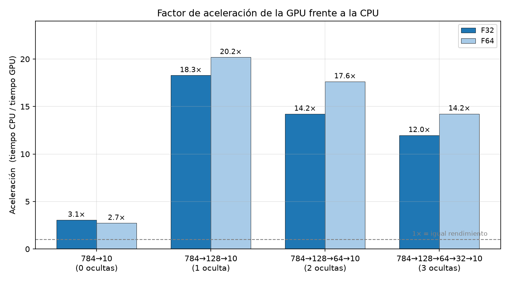
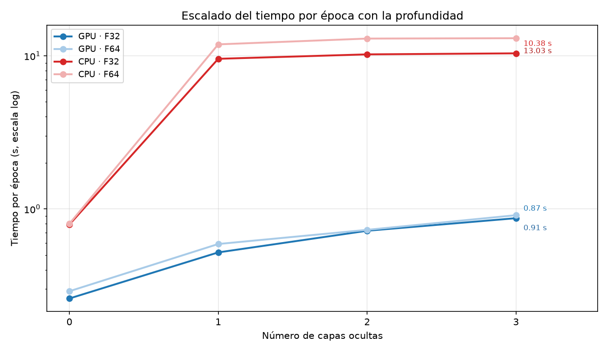
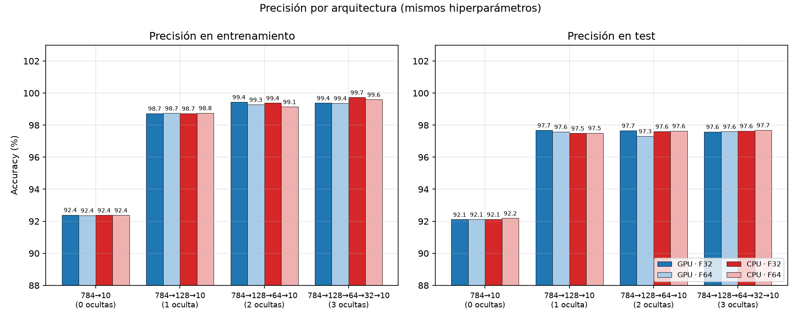

# C-NeuralNetwork

Red neuronal profunda implementada **desde cero en C++17 + CUDA**, sin ninguna librería
externa de deep learning (ni BLAS, ni Eigen, ni frameworks tipo PyTorch/TensorFlow).

El proyecto tiene tres partes:

1. Un **motor de tensores** propio (tipo NumPy/PyTorch) con broadcasting, `matmul`,
   activaciones, semántica completa de C++ (Rule of Five) y **ejecución en CPU y GPU**.
2. Un **perceptrón multicapa (MLP)** entrenado con backpropagation manual sobre **MNIST**,
   con las mismas capas corriendo en CPU o CUDA.
3. Una **suite de tests** CPU/GPU que compara ambas rutas numéricamente, más un
   **benchmark reproducible** de tiempos y precisión entre CPU y GPU.

---

## Arquitectura

```
784 (píxeles)  ->  Linear(128)  ->  ReLU
                ->  Linear(64)   ->  ReLU
                ->  Linear(10)   ->  Softmax  ->  Cross-Entropy
```

- Inicialización **Kaiming/He** en los pesos, `bias` en ceros.
- Activaciones: ReLU (ocultas), Softmax (salida).
- Loss: **cross-entropy** categórico con el gradiente fusionado `(P - Y) / batch_size`.
- Optimizador: **SGD** con learning rate configurable (CPU y GPU).
- La arquitectura es **configurable** en `main4` (número de capas y tamaños).

---

## Estructura del proyecto

```
.
├── main.cpp             # Suite de 27 tests del motor de tensores y capas (CPU)
├── main2.cpp            # Entrenamiento y evaluación del MLP en MNIST (CPU)
├── main3.cpp            # Suite de tests CUDA del motor de tensores
├── main4.cpp            # Entrenamiento MLP configurable (device / dtype / capas)
├── execute.sh           # Compila y ejecuta main.cpp + main2.cpp
├── execute_cuda.sh      # Compila y ejecuta main3.cpp
├── train.sh             # Compila y ejecuta main4.cpp (entrenamiento configurable)
├── benchmark.sh         # Benchmark GPU vs CPU: 4 arquitecturas x 2 devices x 2 dtypes
├── make_figures.py      # Regenera las figuras del README desde comparativa.csv
├── requirements.txt     # Dependencias de Python (solo matplotlib, para make_figures.py)
├── comparativa.txt/.csv # Resultados crudos del último benchmark
├── docs/
│   └── figures/         # Figuras del benchmark (PNG, usadas por este README)
├── lib/
│   ├── tensor.h/.cpp    # Clase Tensor: memoria, shape, strides, dtypes, devices (CPU/CUDA)
│   ├── ops.h/.cpp       # add, sub, mult, div, matmul, relu, softmax + broadcasting
│   ├── ops.cu           # Kernels CUDA: binarios, relu, softmax (+backward), matmul,
│   │                    #   bias-accum, relu backward y SGD
│   ├── kernel_operations.h/.cu   # Kernels CUDA del tensor: arange, fill, transpose, randn
│   ├── linear.h/.cpp    # LinearLayer, ReLU y SoftMax (forward + backward, CPU/CUDA)
│   ├── loss.h/.cpp/.cu  # cross_entropy (devuelve loss y gradiente; CPU/CUDA)
│   ├── optim.h          # SGD: zero_grad() y step() (CPU/CUDA)
│   └── dataset.h        # Carga de MNIST en CSV y extracción de minilotes
└── data/
    └── mnist-main/
        ├── mnist_train.csv/   # 60,000 muestras
        └── mnist_test.csv/    # 10,000 muestras
```

---

## Requisitos

- **nvcc** (CUDA Toolkit 12.x) con soporte de **C++17**
- **GPU NVIDIA** (para `--device cuda`; todo funciona también en CPU)
- Dataset MNIST en CSV ya incluido en `data/`
- *(Opcional)* Python 3 + matplotlib para regenerar las figuras del README:
  `pip install -r requirements.txt` (o directamente `uv run --with matplotlib python3 make_figures.py`)

No hace falta instalar nada más: solo la biblioteca estándar de C++ y CUDA.

> **Nota:** todo se compila con `nvcc` aunque el archivo sea `.cpp`, porque los
> fuentes (`tensor.cpp`, `ops.cpp`, `linear.cpp`, `loss.cpp`) invocan kernels CUDA.

---

## Compilación y ejecución

### Suite de tests del motor y las capas (27 tests, CPU)

```bash
nvcc -std=c++17 -O2 main.cpp lib/tensor.cpp lib/ops.cpp lib/linear.cpp lib/loss.cpp lib/kernel_operations.cu lib/ops.cu lib/loss.cu -o programa.out -lcudart -lcurand
./programa.out
```

### Suite de tests CUDA (12 tests de kernels)

```bash
nvcc -std=c++17 -O2 main3.cpp lib/tensor.cpp lib/kernel_operations.cu -o programa_cuda.out -lcudart -lcurand
./programa_cuda.out
```

### Entrenamiento MNIST (CPU, main2)

```bash
nvcc -std=c++17 -O2 main2.cpp lib/tensor.cpp lib/ops.cpp lib/linear.cpp lib/loss.cpp lib/kernel_operations.cu lib/ops.cu lib/loss.cu -o programa.out -lcudart -lcurand
./programa.out
```

### Entrenamiento configurable (main4)

```bash
./train.sh [opciones]
```

`train.sh` compila `main4.cpp` y ejecuta el entrenamiento con las opciones indicadas:

| Opción | Descripción | Defecto |
|---|---|---|
| `--device cpu\|cuda` | Device de entrenamiento | `cuda` |
| `--dtype f32\|f64` | Tipo de dato | `f32` |
| `--layers 784,128,64,10` | Arquitectura del MLP | `784,128,64,10` |
| `--epochs N` | Número de épocas | `15` |
| `--batch N` | Tamaño del minilote | `64` |
| `--lr F` | Learning rate | `0.08` |
| `--limit N` | Limitar muestras de entrenamiento | `-1` (todas) |
| `--eval-batch N` | Batch de evaluación | `128` |
| `--train PATH` / `--test PATH` | CSV de entrenamiento / test | rutas de `data/` |

Ejemplos:

```bash
./train.sh                                            # GPU, F32, 784-128-64-10
./train.sh --device cpu --limit 10000                 # CPU con 10k muestras
./train.sh --dtype f64 --epochs 5                     # doble precisión
./train.sh --layers 784,256,128,64,10 --lr 0.05       # otra arquitectura
```

### Benchmark GPU vs CPU

```bash
./benchmark.sh              # matriz completa (~35-40 min); EPOCHS=5 para una pasada rápida
```

Ejecuta 16 entrenamientos completos (4 arquitecturas × 2 devices × 2 dtypes) y
guarda toda la salida en streaming en `comparativa.txt` + las métricas en
`comparativa.csv`.

### Figuras del README (cómo regenerarlas)

Las 4 figuras de la sección [Resultados](#resultados-del-benchmark-gpu-vs-cpu)
se generan desde `comparativa.csv` con `make_figures.py`:

```bash
# 1. (Opcional) regenerar los datos lanzando el benchmark completo
./benchmark.sh

# 2. Instalar la dependencia (matplotlib)
pip install -r requirements.txt
#    ...o sin instalar nada, con uv:
#    uv run --with matplotlib python3 make_figures.py

# 3. Generar las figuras
python3 make_figures.py            # -> docs/figures/*.png
```

| Figura | Contenido |
|---|---|
| `docs/figures/tiempo_total.png` | Tiempo total por arquitectura (barras agrupadas GPU/CPU × F32/F64, escala log) |
| `docs/figures/aceleracion_gpu_cpu.png` | Factor de aceleración CPU/GPU por arquitectura y dtype |
| `docs/figures/precision.png` | Precisión train/test por arquitectura |
| `docs/figures/escalado_profundidad.png` | Tiempo por época frente al número de capas ocultas |

El script acepta rutas alternativas como argumentos:
`python3 make_figures.py otro.csv otra/carpeta_salida`.

---

## Resultados del benchmark: GPU vs CPU

**4 arquitecturas (de 0 a 3 capas ocultas) × 2 devices × 2 dtypes = 16
entrenamientos completos** sobre MNIST (60 000 muestras, 15 épocas, batch 64,
lr 0.08). GPU: **NVIDIA GeForce RTX 5080** (CUDA 12.4). CPU: **AMD Ryzen 7
8700F** (ejecución monohilo). Los tiempos miden solo el bucle de entrenamiento
(no incluyen la carga del dataset ni la evaluación).

### Tiempos

| Arquitectura | Device | Dtype | Tiempo (s) | s/época | Acc train | Acc test |
|---|---|---|---|---|---|---|
| 784→10 (0 ocultas) | CUDA | F32 | 3.86 | 0.26 | 92.40% | 92.11% |
| 784→10 (0 ocultas) | CUDA | F64 | 4.43 | 0.29 | 92.37% | 92.12% |
| 784→10 (0 ocultas) | CPU | F32 | 11.80 | 0.79 | 92.38% | 92.12% |
| 784→10 (0 ocultas) | CPU | F64 | 12.08 | 0.80 | 92.38% | 92.19% |
| 784→128→10 (1 oculta) | CUDA | F32 | 7.84 | 0.52 | 98.73% | 97.68% |
| 784→128→10 (1 oculta) | CUDA | F64 | 8.83 | 0.59 | 98.74% | 97.59% |
| 784→128→10 (1 oculta) | CPU | F32 | 143.34 | 9.56 | 98.73% | 97.49% |
| 784→128→10 (1 oculta) | CPU | F64 | 178.26 | 11.88 | 98.76% | 97.51% |
| 784→128→64→10 (2 ocultas) | CUDA | F32 | 10.78 | 0.72 | 99.44% | 97.66% |
| 784→128→64→10 (2 ocultas) | CUDA | F64 | 11.03 | 0.73 | 99.28% | 97.31% |
| 784→128→64→10 (2 ocultas) | CPU | F32 | 153.25 | 10.22 | 99.38% | 97.61% |
| 784→128→64→10 (2 ocultas) | CPU | F64 | 194.45 | 12.96 | 99.14% | 97.64% |
| 784→128→64→32→10 (3 ocultas) | CUDA | F32 | 13.00 | 0.87 | 99.38% | 97.59% |
| 784→128→64→32→10 (3 ocultas) | CUDA | F64 | 13.72 | 0.91 | 99.37% | 97.60% |
| 784→128→64→32→10 (3 ocultas) | CPU | F32 | 155.68 | 10.38 | 99.73% | 97.64% |
| 784→128→64→32→10 (3 ocultas) | CPU | F64 | 195.38 | 13.03 | 99.60% | 97.69% |

### Factor de aceleración (tiempo CPU / tiempo GPU)

| Arquitectura | F32 | F64 |
|---|---|---|
| 784→10 (0 ocultas) | 3.1× | 2.7× |
| 784→128→10 (1 oculta) | 18.3× | 20.2× |
| 784→128→64→10 (2 ocultas) | 14.2× | 17.6× |
| 784→128→64→32→10 (3 ocultas) | 12.0× | 14.2× |


*Tiempo total de entrenamiento (15 épocas, 60 000 muestras). Escala logarítmica:
la CPU pasa de ~12 s a ~195 s según la arquitectura, mientras la GPU se mantiene
entre 3.9 s y 13.7 s.*


*Factor de aceleración (tiempo CPU / tiempo GPU). El máximo (18-20×) se alcanza
en cuanto la red tiene una capa oculta; la red lineal (matrices muy pequeñas)
solo gana ~3× porque domina el coste de lanzar kernels.*


*Tiempo por época frente al número de capas ocultas. En CPU el coste lo domina
la primera capa (784→128): ~9.5-10.4 s/época que apenas crecen al añadir capas;
en GPU todo escala de forma mucho más suave (0.26→0.87 s/época).*


*Precisión con los mismos hiperparámetros. Todas las redes con al menos una capa
oculta saturan ~97.5-97.7 % en test; el clasificador lineal (0 ocultas) se queda
en ~92 %. La precisión en train sigue subiendo con la profundidad (99.7 % con 3
ocultas) → sobreajuste creciente.*

### Lectura de los resultados

**Tiempos.** En CPU, el coste está dominado por la primera capa (784→128): unas
9.5-10.4 s/época que apenas crecen al añadir las capas siguientes (128→64→32 son
matrices pequeñas). Por eso la red lineal (784→10, sin ocultas) tarda solo
~0.8 s/época, y cualquier red con una capa ancha se multiplica por ~12. En GPU
el reparto es mucho más equilibrado: de 0.26 s/época (lineal) a 0.87 s/época
(3 ocultas), un factor ×3.3 frente al ×13 del CPU. Con la GPU, entrenar 15
épocas completas son **segundos** (3.9-13.7 s); en CPU, **minutos** (12-195 s).

**Aceleración.** La ventaja de la GPU aparece en cuanto hay una capa oculta:
**12-20×** en todas las redes no lineales, con el pico en 784→128→10 (18-20×).
En la red lineal solo gana ~3×: con matrices tan pequeñas el tiempo se va en
lanzar kernels y sincronizar, no en computar. F64 cuesta un +5-12 % en GPU
(la GPU domina por latencia de kernel) y un +20-25 % en CPU (matmul naive en
doble precisión).

**Precisión.** La profundidad mejora claramente el train (92.4 % → 99.7 %) pero
el test satura en ~97.5-97.7 % a partir de una capa oculta: añadir capas extra
no generaliza mejor, solo sobreajusta más. F32 y F64 dan precisiones
indistinguibles. Las pequeñas diferencias entre runs de la misma arquitectura
son ruido de inicialización (los pesos se inicializan sin semilla fija).

---

## Detalles de implementación

### Motor de tensores (`lib/tensor.h`)

La clase `Tensor` es un wrapper de memoria con metadatos, al estilo de PyTorch:

- **Shape** multidimensional con `int64_t` y **strides** calculados automáticamente.
- **Dtypes**: `F32`, `F64`, `I32`, `I64`.
- **Devices**: `CPU` y `CUDA` (memoria con `operator new` alineado / `cudaMalloc`).
- **Semántica de movimiento** completa (constructor y asignación por movimiento).
- **Factory methods**: `zeros`, `ones`, `arange`, `randn` (en GPU vía kernels + cuRAND).
- **Utilidades**: `clone()`, `flatten()`, `transpose()`.

### Dispatch de tipos (macro `DISPATCH_ALL_TYPES`)

El "kernel" de cada operación se genera una vez por tipo y se compila como
`switch` sobre el `DType`. El mismo código sirve para `float`, `double` o enteros,
tanto en CPU como en GPU (los functors de CUDA están templateados por `scalar_t`).

### CUDA (`lib/ops.cu`, `lib/kernel_operations.cu`, `lib/loss.cu`)

Cada operación tiene su kernel con un patrón común:

- **Binarias** (`add/sub/mult/div`): fast path mismo-shape + kernel con broadcasting
  (strides expandidos con 0 en las dimensiones repetidas).
- **`matmul`**: kernel 2D `[M,K]@[K,N]` con un hilo por elemento; el loop de batches
  (con broadcasting) vive en `ops.cpp` y lanza un kernel por batch.
- **`softmax`**: un bloque por fila, reducciones de max y suma en shared memory.
  Su **backward** usa el mismo esquema (un bloque por fila) reduciendo el producto
  punto `Σ dL/dp·p`.
- **`cross_entropy`**: kernel de gradiente `(P-Y)/B` + sumas parciales por bloque y
  kernel final que escribe `-suma * b_inv` (sin `atomicAdd(double)`, que no existe
  para arquitecturas < sm_60).
- **Backward**: `bias_accum` (un hilo por columna) y `relu_backward` (máscara `x>0`).
- **SGD**: `zero_grad` con `cudaMemset` + kernel `param -= lr * grad`.

### Broadcasting (`lib/ops.cpp`)

`add`, `sub`, `mult` y `div` soportan broadcasting tipo NumPy (`[2,3] + [3]`,
`[2,3] - [2,1]`, etc.) tanto en CPU como en CUDA. Se calculan los *strides* de salida
expandiendo con `stride = 0` las dimensiones que se repiten.

### Backpropagation

Cada capa cachea lo que necesita para el paso backward:

- `LinearLayer` guarda `input_cache` y calcula `d_weights = Xᵀ · dZ` y `d_bias = Σ dZ`.
- `ReLU` guarda la entrada y enmascara el gradiente con `(x > 0)`.
- `SoftMax` guarda las probabilidades y aplica el Jacobiano fila a fila:
  `dL/dz_j = p_j · (dL/dp_j − Σ_k dL/dp_k · p_k)`.
- `cross_entropy` devuelve **loss y gradiente** en un solo recorrido (variante
  fusionada, gradiente directo `(P−Y)/B`, el camino estándar y más eficiente).
  El TEST 27 de `main.cpp` verifica que la composición `cross_entropy` + `SoftMax::backward`
  produce exactamente el mismo gradiente que la variante fusionada.
- `SGD::zero_grad()` limpia los gradientes antes de cada iteración.

---

## Estado del proyecto

Implementado:

- [x] Motor de tensores con broadcasting y dtypes múltiples (CPU y CUDA)
- [x] Suite de 27 tests del motor de tensores y capas (CPU)
- [x] Suite de tests CUDA del motor (main3)
- [x] Kernels CUDA para todas las operaciones: binarias, `matmul`, `softmax`
      (forward y backward), cross-entropy, bias-accum, ReLU backward y SGD
- [x] Capas `Linear`, `ReLU` y `SoftMax` con forward y backward en CPU y CUDA
- [x] `cross_entropy` con gradiente (CPU y CUDA), variante fusionada
- [x] Optimizador SGD (CPU y CUDA)
- [x] Entrenamiento end-to-end en MNIST: CPU (main2), GPU y configurable (main4)
- [x] Benchmark reproducible GPU vs CPU (`benchmark.sh`) y figuras (`make_figures.py`)

Pendiente / ideas:

- [ ] Shuffle de los datos y batches por época (hoy el orden es fijo)
- [ ] `Adam` / otros optimizadores
- [ ] `matmul` con `cuBLAS` o tiling en shared memory (el kernel actual es naive)
- [ ] Capas convolutivas para comparar con una CNN clásica
- [ ] Guardar y cargar pesos del modelo entrenado

---

## Notas

- El dataset se carga **completo en memoria** en CPU (60,000 × 784 floats ≈ 188 MB);
  en `main4` cada minilote se transfiere al device elegido con `cudaMemcpy`.
- `evaluate_accuracy` solo procesa los batches completos (`count / batch_size`);
  las muestras sobrantes del último batch no se evalúan.
- `execute.sh` reconstruye y ejecuta `main.cpp` y `main2.cpp`; `train.sh` hace lo
  propio con `main4.cpp`; `benchmark.sh` lanza la comparativa completa y deja los
  resultados en `comparativa.txt`/`comparativa.csv`.
- Las figuras de `docs/figures/` se regeneran desde `comparativa.csv` con
  `make_figures.py`; si repites el benchmark, vuelve a ejecutar el script para
  mantener las imágenes sincronizadas con los datos.
